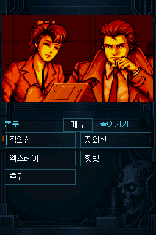
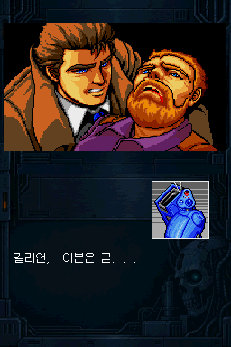

# DS-Snatcher-Kr-MegaCD-Porting · v0.95

<p align="center"></p>

> **V0.95는 전체 테스트용 사전 릴리스입니다. 완성판이 아닙니다. 버그와 일부 구간·선택 분기의 진행 불가, 사운드 끊김이 남아 있을 수 있습니다.**
>
> ACT 1~3 전체 스토리 범위를 시험하는 버전이며, 모든 분기와 실기 조합의 정상 동작을 보장하지 않습니다.

**[Mega-CD판 SNATCHER 한글패치](https://github.com/OldManCraveGuitars-bit/MegaCD-Snatcher-Kr)를 기반으로 제작한 Nintendo DS용 비공식 이식입니다. 이번 버전은 원본 한글패치 V0.95의 번역·보이스 자막을 반영했습니다.**

상단은 장면 그림, 하단은 대사·초상화·터치 선택지와 조작으로 구성했습니다. 원본 게임·BIOS·완성 NDS는 배포하지 않으며, 패처가 사용자가 보유한 원본으로 NDS를 생성합니다.

## 다운로드

- **[Windows EXE 패처](https://github.com/OldManCraveGuitars-bit/DS-Snatcher-Kr-MegaCD-Porting/releases/download/v0.95/Snatcher-DS-v0.95-Patcher.exe)** — Python 설치 없이 실행.
- **[패처·사용 방법·라이선스·대응 소스 ZIP](https://github.com/OldManCraveGuitars-bit/DS-Snatcher-Kr-MegaCD-Porting/releases/download/v0.95/DS-Snatcher-Kr-MegaCD-Porting-v0.95-Patcher.zip)**
- [V0.95 릴리스](https://github.com/OldManCraveGuitars-bit/DS-Snatcher-Kr-MegaCD-Porting/releases/tag/v0.95) · [배포 파일 SHA-256](https://github.com/OldManCraveGuitars-bit/DS-Snatcher-Kr-MegaCD-Porting/blob/v0.95/SHA256SUMS-v0.95.txt) · [입력 ROM·BIOS SHA-256](INPUT-SHA256-v0.95.txt)

## 이번 변경

- **Mega-CD 한글패치 V0.95의 최신 r57 번역** 반영: 기존 81쪽 수정, 누락된 “길리언, 이분은 곧...” 자막 1쪽 추가. 기존 자막 번호와 음성 재생 시각은 유지합니다.
- 사운드 믹싱의 불필요한 계산을 제거하고 FM 필터·화면 합성을 최적화했습니다. ACT3 도입부와 이동·전투 장면의 부하를 줄이는 수정이며, 실기 끊김의 완전 해소를 보장하지는 않습니다.
- 비디오폰 잡음이 반만 보이던 문제, 일부 길리언 입 표정 겹침과 장면에 남는 그림을 수정했습니다.
- **손전등 메뉴를 십자키로 선택하고 A로 실행**할 수 있습니다. 기존 터치 조작도 유지합니다.
- 전투 LIFE 표시, 소리 개별 On/Off, 클리어 저장 표기, 실행 아이콘과 NitroFS 호환성 수정은 유지합니다.
- 시작 메뉴 아래 화면의 ‘스네쳐’ 제목 글씨를 제거했습니다.

아우터헤븐에서 ‘암호의 의미’를 선택한 뒤 발생하는 BGM 잡음 제보는 아직 미해결입니다.

## 패치 방법

1. Windows 10/11 x64 PC에서 EXE를 실행합니다.
2. 수정되지 않은 **북미판 원본 CUE**와 연결된 모든 BIN 트랙, 아래의 **지원 USA BIOS**, **PC 저장 위치**를 지정합니다.
3. **NDS 만들기**를 누릅니다. 한글 V0.95는 자동 적용되며 변환에 수 분이 걸립니다.
4. 완료 후 결과 폴더의 `snatcher_ds.nds`를 SD 카드에 복사합니다. 기존 `snatcher_ds` 저장 폴더는 백업하고 보존하세요.

이미 한글패치한 ROM을 입력하지 않습니다. 원본 파일과 기존 출력 폴더는 덮어쓰지 않습니다. CHD·ZIP·BIN 단독 입력은 지원하지 않습니다. [상세 방법](docs/PATCHING_KO.md)

## 원본 ROM · BIOS 해시

단일 BIN 북미판 `Snatcher (USA).bin` — 625,192,176바이트:

```text
8d6f4dba8d9ce59991be9f65635047adc3b0f37ea2358f8c48b251883c9e55b6
```

지원 USA BIOS `us_scd2_9306.bin` — 131,072바이트:

```text
b1c2036b79467514eaaa69c76e5ba83801621e821059caa53cb921a0b21e3af4
```

이는 **입력 원본의 SHA-256**입니다. 여러 BIN으로 나뉜 원본은 개별 파일 해시를 단일 BIN 값과 직접 비교할 수 없습니다. 패처에는 연결된 CUE를 지정합니다. BIOS는 위 해시와 일치하는 파일을 사용해야 합니다.

## 화면

| V0.95 · ACT3 도입부 | V0.95 · 복구한 누락 자막 |
| --- | --- |
|  |  |

아래 전투·회상·보이스 이미지는 이전 검증 기록입니다. 로고와 접수처는 V0.95 패처의 실제 결과로 다시 캡처했습니다.

| 첫 전투 · 통일한 LIFE 표시 | ACT2 회상 · V0.9 자막 |
| --- | --- |
|  |  |

| 접수처 · 오프닝 후 첫 대사 | 보이스 대화 |
| --- | --- |
|  |  |


게임 화면은 에뮬레이터의 256×384 캡처입니다. 실행 아이콘만 확인하기 쉽게 정수 배율로 확대했습니다. 아이콘은 이미지 생성 도구로 제작한 뒤 DS의 16색 규격으로 변환했습니다. 각 캡처의 버전·검사 빌드 해시는 [기록](screenshots/manifest.json)에 구분했습니다.

## 호환성과 검증 범위

일반 DS/DS Lite의 4 MiB 메모리를 기준으로 개발합니다. 게임 내부 저장에는 홈브루 SD/DLDI 읽기·쓰기가 필요합니다. **melonDS DS와 구형 RetroArch melonDS는 다른 코어입니다.** 검사한 구형 melonDS 0.9.3은 홈브루 SD를 제공하지 않아 내부 저장·불러오기를 사용할 수 없습니다. DSi SD 옵션과는 별개입니다.

기존 V0.81에서 ACT 1~3 주요 경로와 엔딩을 연속 검사했습니다. V0.95에서는 최신 번역·누락 자막과 사운드·화면 수정을 포함하고, 패처 출력과 변경 구간을 별도로 검사했습니다. 기존 V0.9 전투·클리어 저장 검사는 이전 기록으로 구분합니다. **V0.95의 모든 분기를 새 게임부터 다시 완주한 것은 아닙니다.** R4 제품·커널별 실기 및 Android APK의 최신 수정본은 별도 확인이 필요합니다.

- [검증 범위](docs/RELEASE_STATUS.md) · [알려진 문제](docs/KNOWN_ISSUES_KO.md)
- [조작과 저장](docs/PLAYING_KO.md) · [소스 재빌드](docs/BUILDING.md)
- [외부 구성 요소와 권리 표기](THIRD_PARTY_NOTICES.md)

이전 V0.1Demo는 변경하지 않는 1회성 데모입니다. V0.95는 별도 전체 테스트용 배포입니다. SNATCHER 원작의 권리는 KONAMI 등 해당 권리자에게 있습니다.
