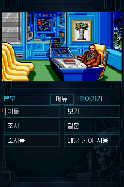
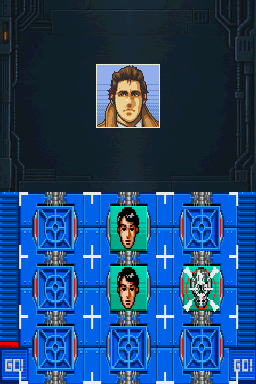
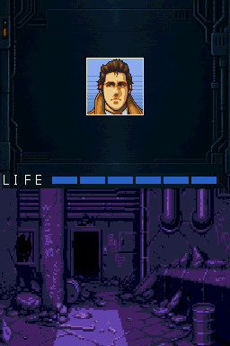

# DS-Snatcher-Kr-MegaCD-Porting

## v0.1Demo

**버그가 남아 있는 개발 중 데모이며, 일부 구간만 플레이 가능합니다. 전체 게임을 끝까지 진행할 수 없습니다.**

**v0.1Demo 패처는 1회성 배포입니다. 이후 배포 버전이 나올 때까지 패처 업데이트를 제공하지 않습니다.**

Mega CD판 **SNATCHER**를 Nintendo DS의 두 화면과 터치 조작에 맞춰 이식하는 비공식 한국어 프로젝트입니다. 대사와 보이스 자막은 **한글 패치 v0.775**를 기준으로 합니다.

### 다운로드와 패치

[v0.1Demo 릴리스](https://github.com/OldManCraveGuitars-bit/DS-Snatcher-Kr-MegaCD-Porting/releases/tag/v0.1Demo)에서 **DS-Snatcher-Kr-MegaCD-Porting-v0.1Demo-Patcher.zip**을 받으십시오.

Windows 64비트 PC에서 본인이 보유한 **깨끗한 미국판 CUE/BIN**과 지원되는 **Sega CD USA BIOS**를 넣으면 실행 가능한 `DS-Snatcher-Kr-v0.1Demo.nds`를 만듭니다. 게임 원본·BIOS·완성 NDS는 배포하지 않습니다.

1. Python 3.12 이상의 **64비트 버전**을 설치합니다.
2. ZIP을 새 폴더에 풀고, 그 폴더의 터미널에서 `py -3 -m pip install -r requirements.txt`를 실행합니다.
3. `Patch-v0.1Demo.cmd`를 열어 원본 CUE, BIOS, 결과를 저장할 위치를 선택합니다.
4. `SUCCESS`가 나온 후 출력 폴더의 NDS를 기기 또는 호환 에뮬레이터에서 실행합니다.

처음 실행에는 Python 패키지 설치가 필요합니다. 자세한 준비물, 지원 입력 해시, 오류 대응은 **[패치 방법](docs/PATCHING_KO.md)**을 확인하십시오. 원본 파일은 변경하지 않습니다.

### 화면

| 접수처 | 국장실 |
| --- | --- |
|  |  |

| 사격 연습 | 폐공장 전투 |
| --- | --- |
|  |  |

패처로 생성한 데모의 실제 에뮬레이터 화면입니다. 원본 256×384 캡처를 수정하지 않았습니다. [스크린샷 기록](screenshots/manifest.json)

### 플레이 범위

- 로고·제목 화면, 두 오프닝, 접수처와 본부 진입.
- 본부의 초기 대화·조사, 하단 터치 선택지와 자판, 사격 연습.
- 터보사이클 이동, 폐공장 조사·전투·탈출과 본부 복귀.
- 한국어 대사·보이스 자막, 저장·불러오기와 ACT·장소 표시.
- TV 필터·스캔라인의 개별 설정과 동시 사용, 전투 초상화·발사·피격·게임오버 연출.

이는 검사한 주요 경로의 범위입니다. **이후 이야기와 엔딩, 모든 분기의 정상 진행은 지원하지 않습니다.** 미구현 구간이나 오류로 진행이 멈출 수 있습니다.

### 알려진 문제

**BGM·효과음·보이스의 끊김, 늘어짐과 구간별 속도 저하가 남아 있습니다.** 특히 사격 연습과 폐공장 탈출·복귀 구간을 포함해 실제 기기에서 성능 차이가 있습니다. 이번 데모를 사운드 문제 해결판으로 안내하지 않습니다.

- [조작·저장·에뮬레이터 안내](docs/PLAYING_KO.md)
- [알려진 문제와 검증 범위](docs/KNOWN_ISSUES_KO.md)
- [패처 검증 기록](docs/RELEASE_STATUS.md)
- [개발자용 소스 빌드](docs/BUILDING.md)
- [외부 코드·폰트·원작 표기](THIRD_PARTY_NOTICES.md)

비공식 팬 이식입니다. 원작 SNATCHER의 권리는 해당 권리자에게 있으며, 외부 코드는 각 라이선스를 따릅니다. 원본 그림·음원·BIOS는 사용자가 가진 파일에서만 생성합니다.
