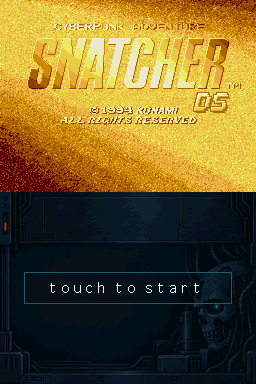
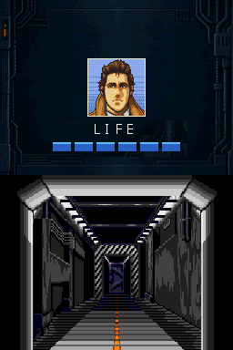
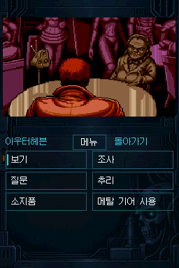
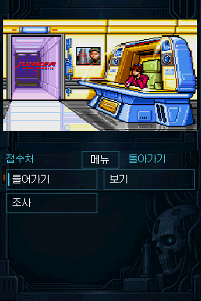
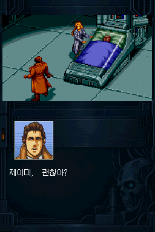

# SNATCHER DS 비공식 한글화·포팅 v1.0

**비공식 한글화·포팅 1.0 정식 버전** · 한글화 및 포팅: **기타 깎는 노인**

**[Mega-CD판 SNATCHER 한글패치](https://github.com/OldManCraveGuitars-bit/MegaCD-Snatcher-Kr)를 기반으로 제작한 Nintendo DS용 비공식 이식입니다.** 원본 한글패치의 최종 검수 번역을 반영해 ACT 1~3와 엔딩을 한국어로 즐길 수 있도록 구성했습니다.

상단에는 장면 그림, 하단에는 대사·초상화·선택지와 터치 조작을 배치했습니다. KONAMI가 제작하거나 승인한 공식 제품은 아닙니다. 원작의 권리는 해당 권리자에게 있습니다.

## 다운로드

- **[Windows EXE 패처](https://github.com/OldManCraveGuitars-bit/DS-Snatcher-Kr-MegaCD-Porting/releases/download/v1.0/Snatcher-DS-v1.0-Patcher.exe)** — 일반 사용자용, 설치 없이 실행
- **[패처·설명서·라이선스·대응 소스 ZIP](https://github.com/OldManCraveGuitars-bit/DS-Snatcher-Kr-MegaCD-Porting/releases/download/v1.0/DS-Snatcher-Kr-MegaCD-Porting-v1.0-Patcher.zip)**
- [v1.0 릴리스](https://github.com/OldManCraveGuitars-bit/DS-Snatcher-Kr-MegaCD-Porting/releases/tag/v1.0) · [배포 파일 SHA-256](SHA256SUMS-v1.0.txt) · [입력 ROM·BIOS SHA-256](INPUT-SHA256-v1.0.txt)

패처는 사용자가 보유한 원본으로 NDS를 생성합니다. **원본 ROM·BIOS·완성 NDS는 배포에 포함하지 않습니다.**

## v1.0 주요 내용

- **최종 한글 번역 반영** — 대사와 보이스 자막의 최종 검수 내용을 적용하고 누락 자막을 보완했습니다. 기존 대사 번호와 음성 재생 시각을 유지합니다.
- **사운드 개선** — 아우터헤븐에서 ‘암호의 의미’ 선택 후 생기던 찢어지는 FM 잡음을 수정했습니다. ACT3 전투, 카메라 이동, 화면 생성·페이드의 처리 부담도 줄였습니다.
- **전투 화면 정리** — 실제 체력이 있는 모든 전투에서 상단 길리언 초상화 아래에 LIFE, 그 아래 중앙에 체력바를 배치합니다. 하단은 조준·사격에 사용합니다.
- **화면·자막 보완** — 비디오폰 잡음 연출, 길리언 입 표정 겹침, 불필요한 그림 노출과 엔딩 문구 표시를 수정했습니다. 엔딩 마지막에는 ‘한글화 및 포팅 / 기타 깎는 노인’ 크레딧을 표시합니다.
- **조작과 설정** — 터치 조작과 버튼 조작을 지원하며 손전등 메뉴는 십자키와 A로도 실행할 수 있습니다. 배경음·효과음·보이스를 각각 켜고 끌 수 있고, 보이스를 꺼도 자막은 유지합니다. 설정의 사운드 체크 항목은 제거했습니다.
- **저장과 진행** — 5개 저장 슬롯과 클리어 기록에 따른 ACT 선택을 지원합니다. ACT3 본부 저장 위치 표시와 ACT 종료 저장 표기를 정리했습니다.

## 패치 방법

1. **Snatcher-DS-v1.0-Patcher.exe**를 실행합니다. Python 설치는 필요하지 않습니다.
2. 수정되지 않은 **북미판 원본 CUE**, 연결된 **모든 BIN 트랙**, **지원 USA BIOS**를 준비합니다. ROM 선택란에는 CUE를 지정합니다.
3. PC의 새 결과 폴더를 지정하고 **NDS 만들기**를 누릅니다. 최종 한글 번역은 자동 적용됩니다.
4. 생성·검증이 완료되면 결과 폴더의 **snatcher_ds.nds**를 SD 카드로 복사합니다.
5. 이전 버전을 사용했다면 **기존 snatcher_ds 저장 폴더 전체를 백업하고 보존**한 채 NDS만 교체합니다.

Windows 10/11 x64용입니다. 변환은 PC에서 이루어지며 원본을 수정하거나 서버로 전송하지 않습니다. 이미 한글패치한 ROM, CHD·ZIP·BIN 단독 입력은 지원하지 않습니다. [자세한 사용 방법](docs/PATCHING_KO.md)

## 원본 ROM · BIOS

| 입력 | 크기 | SHA-256 |
| --- | ---: | --- |
| 북미판 `Snatcher (USA).bin` · 단일 BIN 기준 | 625,192,176바이트 | `8d6f4dba8d9ce59991be9f65635047adc3b0f37ea2358f8c48b251883c9e55b6` |
| USA BIOS `us_scd2_9306.bin` | 131,072바이트 | `b1c2036b79467514eaaa69c76e5ba83801621e821059caa53cb921a0b21e3af4` |

BIOS는 위 해시와 일치해야 합니다. 여러 BIN으로 나뉜 디스크는 각 파일 해시를 단일 BIN 값과 직접 비교할 수 없습니다. 연결된 CUE와 모든 트랙을 준비하세요.

## 게임 화면

| v1.0 · 전투 LIFE와 체력바 | v1.0 · 아우터헤븐 |
| --- | --- |
|  |  |

| v1.0 · 오프닝 후 접수처 | v1.0 · 전투 후 대화 |
| --- | --- |
|  |  |

256×384 에뮬레이터 실제 화면입니다. [스크린샷 출처와 빌드 기록](screenshots/manifest.json)

## 실행 환경과 검증

일반 **DS/DS Lite의 4 MiB 메모리**를 기준으로 개발했습니다. 게임 내부 저장에는 **홈브루 SD/DLDI 읽기·쓰기**를 지원하는 실행 환경이 필요합니다. `melonDS DS`와 구형 RetroArch `melonDS`는 서로 다른 코어이며 저장장치 지원도 다릅니다.

정식판은 최종 번역과 누적 수정사항을 반영한 배포입니다. 최종판 패처의 실제 변환·부팅과 변경 구간을 검사했으며, 과거 ACT 1~3 주요 경로·엔딩 검사와 구분해 기록합니다. **모든 선택 분기와 모든 R4·DSi/3DS·Android 환경을 최종판으로 재검증한 것은 아닙니다.**

기본 TV 필터·스캔라인은 Off입니다. 두 옵션을 끈 상태에서 전투의 경량 표시 경로를 사용합니다. 장치와 SD 카드 환경에 따라 일부 연출에서 끊김이 남을 수 있습니다.

- [조작·저장 안내](docs/PLAYING_KO.md) · [검증 범위](docs/RELEASE_STATUS.md) · [호환성·문제 제보](docs/KNOWN_ISSUES_KO.md)
- [변경 기록](RELEASE_NOTES_KO.md) · [소스 재빌드](docs/BUILDING.md) · [출처·라이선스](THIRD_PARTY_NOTICES.md)
