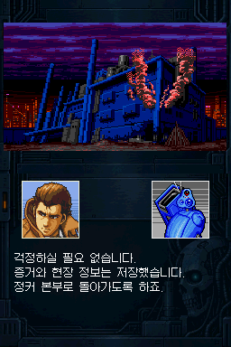
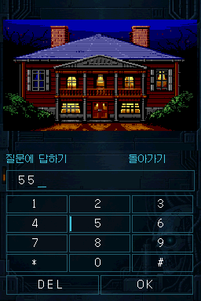
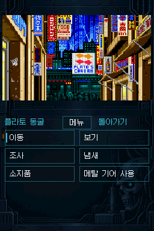

# DS-Snatcher-Kr-MegaCD-Porting · v0.81

<p align="center"></p>

> **v0.81은 전체 테스트용 버전입니다. 완성판이 아니며, 버그·일부 구간의 진행 불가·사운드 끊김이 남아 있을 수 있습니다.**
>
> ACT 1~3 전체 스토리 범위를 대상으로 시험하는 **전체 테스트용 사전 릴리스(Pre-release)**입니다. 주요 경로는 PC 에뮬레이터에서 엔딩까지 확인했지만, 모든 선택 분기와 실기 동작을 검증한 것은 아닙니다.

**이 프로젝트는 [Mega-CD판 SNATCHER 한글패치](https://github.com/OldManCraveGuitars-bit/MegaCD-Snatcher-Kr)를 기반으로 제작한 Nintendo DS용 비공식 이식입니다. 한국어 대사와 보이스 자막은 해당 한글패치 0.81 자료를 반영했습니다.**

Nintendo DS의 두 화면에 맞춰 상단에 장면 그림, 하단에 한국어 대사·초상화·선택지·터치 조작을 배치했습니다. 원본 Mega-CD판 한글패치의 번역·자막 자료를 DS 화면과 조작에 맞게 적용한 버전입니다.

## 다운로드

- **[Windows EXE 패처](https://github.com/OldManCraveGuitars-bit/DS-Snatcher-Kr-MegaCD-Porting/releases/download/v0.81/Snatcher-DS-v0.81-Patcher.exe)** — 약 52 MiB, Python 설치 없이 실행.
- **[패처·사용 방법·라이선스·소스 ZIP](https://github.com/OldManCraveGuitars-bit/DS-Snatcher-Kr-MegaCD-Porting/releases/download/v0.81/DS-Snatcher-Kr-MegaCD-Porting-v0.81-Patcher.zip)** — 배포용 전체 묶음.
- [v0.81 릴리스와 변경 내용](https://github.com/OldManCraveGuitars-bit/DS-Snatcher-Kr-MegaCD-Porting/releases/tag/v0.81) · [파일 해시](SHA256SUMS-v0.81.txt)

본인이 보유한 **수정되지 않은 북미판 CUE와 모든 BIN 트랙**, **지원 Sega CD USA BIOS**가 필요합니다. 게임 원본·BIOS·완성 NDS는 배포하지 않습니다.

## 입력 원본 ROM · BIOS 해시

**북미판 원본 ROM — `Snatcher (USA).bin` (단일 BIN 기준, 625,192,176바이트)**

```text
SHA-256: 8d6f4dba8d9ce59991be9f65635047adc3b0f37ea2358f8c48b251883c9e55b6
```

**지원 Sega CD USA BIOS — `us_scd2_9306.bin` (131,072바이트)**

```text
SHA-256: b1c2036b79467514eaaa69c76e5ba83801621e821059caa53cb921a0b21e3af4
```

위 값은 **패처에 넣을 원본 파일**의 해시입니다. 패처의 ROM 선택란에서는 연결된 **CUE**를 선택하세요. 여러 BIN 트랙으로 나뉜 원본은 각 파일의 해시가 위 단일 BIN 해시와 다르며 직접 비교할 수 없습니다. [원본 해시 텍스트](INPUT-SHA256-v0.81.txt)

## 패치 방법

1. Windows 10/11 64비트 PC에서 EXE를 실행합니다.
2. **원본 ROM (.cue)**, **Sega CD BIOS**, **PC 저장 위치**를 차례로 선택합니다.
3. **NDS 만들기**를 누릅니다. 한글 0.81은 자동 적용됩니다.
4. 완료 후 **결과 폴더 열기**를 눌러 `snatcher_ds.nds`를 확인하고 SD 카드에 복사합니다.

기존 `snatcher_ds` 저장 폴더는 먼저 백업하세요. 패처는 원본 파일과 기존 결과를 덮어쓰지 않습니다. 이미 한글패치한 ROM을 입력하거나 Mega-CD 패치를 먼저 적용할 필요는 없습니다. [지원 BIOS·상세 패치 방법](docs/PATCHING_KO.md)

## 실제 화면

| 접수처 · 터치 선택지 | 보이스 대화 · 한국어 자막 |
| --- | --- |
|  |  |

| 터치 자판 | 플라토 거리 |
| --- | --- |
|  |  |

패처가 생성하는 동일 NDS의 실제 에뮬레이터 캡처입니다. 원본 256×384 화면을 편집하지 않았습니다. [캡처 기록](screenshots/manifest.json)

## 이번 버전의 범위

- Mega-CD판 한글패치 **0.81**의 대사·보이스 자막 반영.
- **ACT 1~3와 엔딩 주요 경로**를 같은 실행 파일과 새 프로필에서 이어서 검사.
- 하단 터치 대사·선택지·자판·사격·손전등 조작, 상단 그림과 하단 초상화 분리.
- 전역 저장 슬롯 5개, 클리어 기록과 기록이 있을 때의 숨겨진 ACT 선택.
- BGM 처리 부하를 줄인 사운드 경로와 화면 비율·초상화 배치 수정 반영.
- 원본 ROM과 BIOS를 고르는 **설치 불필요 EXE 패처** 제공.

**전체 테스트용이라는 말은 모든 구간의 무결점을 뜻하지 않습니다.** 일부 선택·연출·기기 조합에서 진행 오류, 화면 문제, 속도 저하와 소리 끊김이 발생할 수 있습니다. [알려진 문제](docs/KNOWN_ISSUES_KO.md) · [검증 범위](docs/RELEASE_STATUS.md)

## 조작·출처·소스

- [조작과 저장 안내](docs/PLAYING_KO.md)
- [Mega-CD 원본 한글패치 0.81](https://github.com/OldManCraveGuitars-bit/MegaCD-Snatcher-Kr/releases/tag/v0.81)
- [소스와 재빌드 안내](docs/BUILDING.md)
- [외부 구성 요소와 권리 표기](THIRD_PARTY_NOTICES.md)

기존 [v0.1Demo](https://github.com/OldManCraveGuitars-bit/DS-Snatcher-Kr-MegaCD-Porting/releases/tag/v0.1Demo)는 이전 1회성 데모로 보존합니다. 이번 v0.81은 별도 전체 테스트용 배포입니다. SNATCHER 원작의 권리는 KONAMI 등 해당 권리자에게 있습니다.
